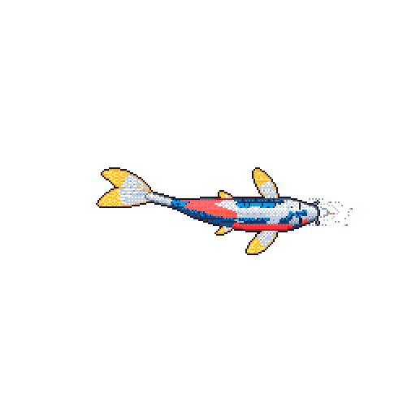

# Hi, I'm David.

I'm a Software Engineering student at **Xiamen University Malaysia**.

I like building software that solves real problems and feels good to use. I'm especially interested in the space between **engineering, product thinking, and interface design**.

### What I'm exploring

- **Product engineering** — turning ideas into useful, reliable web applications.
- **iOS development** — learning to build thoughtful native experiences with SwiftUI.
- **UI/UX** — responsive layouts, accessibility, and the small interaction details.
- **AI in development** — using new tools without losing sight of good engineering.

### Tools & technologies

`TypeScript` · `JavaScript` · `React` · `Next.js` · `SwiftUI` · `Python` · `PHP` · `SQL` · `C++`

### My Git Koi

A little koi growing with my GitHub contributions.

